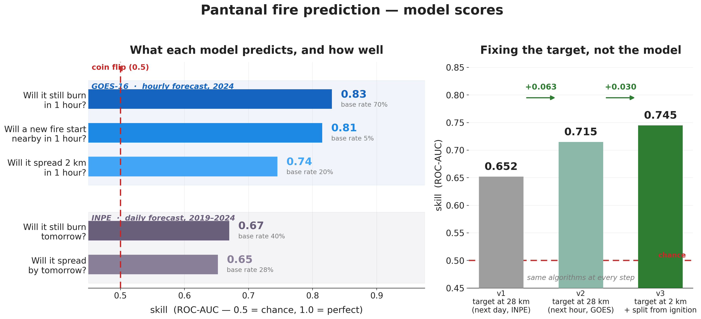

# Wildfire persistence, spread and ignition in the Pantanal

Hour-by-hour machine-learning forecasts of wildfire behaviour in the Pantanal (Brazil), the world's largest tropical wetland, built from GOES-16 geostationary fire detections, INPE fire hotspots and ERA5 hourly weather.

Mobility internship project by **Abdelwahab LAKSIRI** (EMINES – School of Industrial Management, Université Mohammed VI Polytechnique, Morocco) at **LAMMOC** (Climate System Monitoring and Modeling Laboratory), Universidade Federal Fluminense (UFF), Rio de Janeiro, Brazil, supervised by **Prof. Marcio CATALDI**.

## Start here

| | |
|---|---|
| [`pantanal_fire_project_walkthrough.ipynb`](pantanal_fire_project_walkthrough.ipynb) | Guided walkthrough of the whole project, written for readers without a data-science background. All outputs are saved, so it reads directly on GitHub. |
| [`report/report.pdf`](report/report.pdf) | Full internship report (45 pages). |

## Main results

Five models, each scored on a later period than the one it was trained on. ROC-AUC: 0.5 = coin flip, 1.0 = perfect.

| Question | Data | Horizon | Base rate | ROC-AUC |
|---|---|---|---|---|
| Will this fire still burn in 1 hour? | GOES-16, 2024 | 1 h | 70% | **0.830** |
| Will a new fire start nearby in 1 hour? | GOES-16, 2024 | 1 h | 5%* | **0.815** |
| Will this fire spread to adjacent 2 km ground in 1 hour? | GOES-16, 2024 | 1 h | 20% | **0.745** |
| Will this fire still burn tomorrow? | INPE, 2019–2024 | ~24 h | 40% | 0.670 |
| Will fire spread around it by tomorrow? | INPE, 2019–2024 | ~24 h | 28% | 0.652 |

\* after sampling non-events 20:1; the true hourly ignition rate is 0.39%.



**Weather improves only the spread forecast.** Across five monthly forecasts (June–October 2024), adding ERA5 weather to the fire-state features improved spread in every month (+0.012 PR-AUC, t = 3.76, p = 0.020), and added nothing measurable to persistence (p = 0.99) or ignition (p = 0.89). Persistence over one hour follows the fire's own momentum; spread follows wind (it favours the downwind direction and doubles from the calmest to the windiest conditions); ignition follows existing, largely human-set fire activity.

## How the project evolved

| Stage | What was done | What it showed |
|---|---|---|
| 0 | Audit of the laboratory's existing daily model | Its 0.93 persistence score is mostly a table-filtering artefact: a one-line rule scores 0.905 |
| 1 | INPE detections + hourly ERA5 weather, 2019–2024 ([`hourly_model/`](hourly_model/)) | Hourly wind gives a real gain for next-day persistence (3.4σ); but INPE sees the Pantanal once a day, so the target cannot be hourly |
| 2 | GOES-16 fire product every hour, validated against INPE, on 28 km cells ([`goes_hourly_model/`](goes_hourly_model/)) | 1-hour persistence ROC-AUC 0.83; the 28 km "spread" target fails physical checks (it implies a 7.7 m/s fire front) |
| 3 | Fire stored at the native 2 km pixel; spread separated from ignition | Physically consistent spread target (0.56 m/s, downwind bias, z = 25.6); weather matters for spread only |

Most of the progress came from defining the target correctly: the spread model went from ROC-AUC 0.652 to 0.715 to 0.745 with the same algorithms at every step.

## Repository layout

```
├── pantanal_fire_project_walkthrough.ipynb   guided walkthrough of everything below
├── hourly_model/                             Stage 1: INPE detections + hourly ERA5 (2019-2024)
│   ├── build_fire_events_hourly.py             INPE hotspots -> fire clusters (DBSCAN)
│   ├── download_era5_pantanal.py               hourly ERA5 download (Copernicus CDS API)
│   ├── build_hourly_dataset.py                 fire chains, targets, hourly features
│   ├── ml_persistence_spread_hourly.ipynb      tuned XGBoost / random forest models
│   ├── feature_set_effect_size.py              feature blocks vs seed noise
│   └── results/                                metrics, importances, figures
├── goes_hourly_model/                        Stages 2-3: GOES-16 hourly target (2024)
│   ├── goes_grid.py                            GOES fixed grid <-> latitude/longitude, mask codes
│   ├── build_goes_hourly.py                    hourly fire mask per 0.25° cell
│   ├── validate_goes_vs_inpe.py                August 2024 validation against INPE
│   ├── build_goes_model_table.py               28 km model table
│   ├── train_goes_hourly.py                    28 km persistence / spread models
│   ├── build_goes_pixels.py                    native 2 km fire-pixel store
│   ├── build_goes_split_targets.py             2 km spread and ignition tables
│   ├── train_goes_split.py                     spread and ignition models
│   ├── make_*_figures.py                       figures
│   └── results/                                metrics, effect sizes, monthly folds, figures
└── report/                                   internship report (LaTeX source + PDF) and its figures
```

Each model folder has its own README with the full details of its design decisions and results.

## Data

No data is stored in this repository. The scripts download the public datasets themselves:

| Dataset | Source | Access |
|---|---|---|
| INPE fire hotspots, reference satellite (`Brasil_sat_ref`) | [INPE Programa Queimadas annual archive](https://dataserver-coids.inpe.br/queimadas/queimadas/focos/csv/anual/Brasil_sat_ref/) | public; `build_fire_events_hourly.py` downloads the annual archives |
| ERA5 hourly data on single levels | [Copernicus Climate Data Store](https://cds.climate.copernicus.eu/) | free account and API key in `~/.cdsapirc`; `download_era5_pantanal.py` |
| GOES-16 ABI L2 Fire/Hot Spot Characterization (`ABI-L2-FDCF`) | NOAA, public bucket `noaa-goes16` on AWS | public, no account; `build_goes_hourly.py`, `build_goes_pixels.py` |

Three inputs were provided by LAMMOC/UFF and are not public: the hourly XHWI heatwave index (`xhwi_era5_hourly_2024.nc`, 2024 only), and the daily atmospheric blocking and SACZ series (`serie_diaria_bloqueios_clima80_10.csv`, `SACZ_daily_series.csv`). When present, they go in the repository root. The table builder skips them if they are missing; the Stage 1 baseline feature list includes the blocking and SACZ columns, so it must be edited to drop them. Section 4 of the walkthrough analyses the laboratory's own daily model, whose files are not included; its saved outputs show the results.

ERA5 data: generated using Copernicus Climate Change Service information. Neither the European Commission nor ECMWF is responsible for any use of it.

## Reproducing the results

```bash
pip install -r requirements.txt
```

Stage 1 (run inside `hourly_model/`):

```bash
python build_fire_events_hourly.py --years 2019-2024 --states "MATO GROSSO DO SUL,MATO GROSSO"
python download_era5_pantanal.py --years 2019-2024
python build_hourly_dataset.py
python feature_set_effect_size.py --seeds 5
```

Stages 2–3 (run inside `goes_hourly_model/`):

```bash
python build_goes_hourly.py --year 2024 --month 1        # once per month, 1 to 12
python validate_goes_vs_inpe.py --year 2024 --month 8
python build_goes_model_table.py --year 2024
python train_goes_hourly.py --mode both --trials 20 --seeds 5
python build_goes_pixels.py --year 2024 --months 1-12
python build_goes_split_targets.py --year 2024 --months 1-12
python train_goes_split.py --period 2024_01-12
```

Every script lists its options with `--help`. The walkthrough notebook reads the files these scripts produce; with `RECOMPUTE = True` in its first code cell it re-runs every experiment (about an hour on a laptop).
